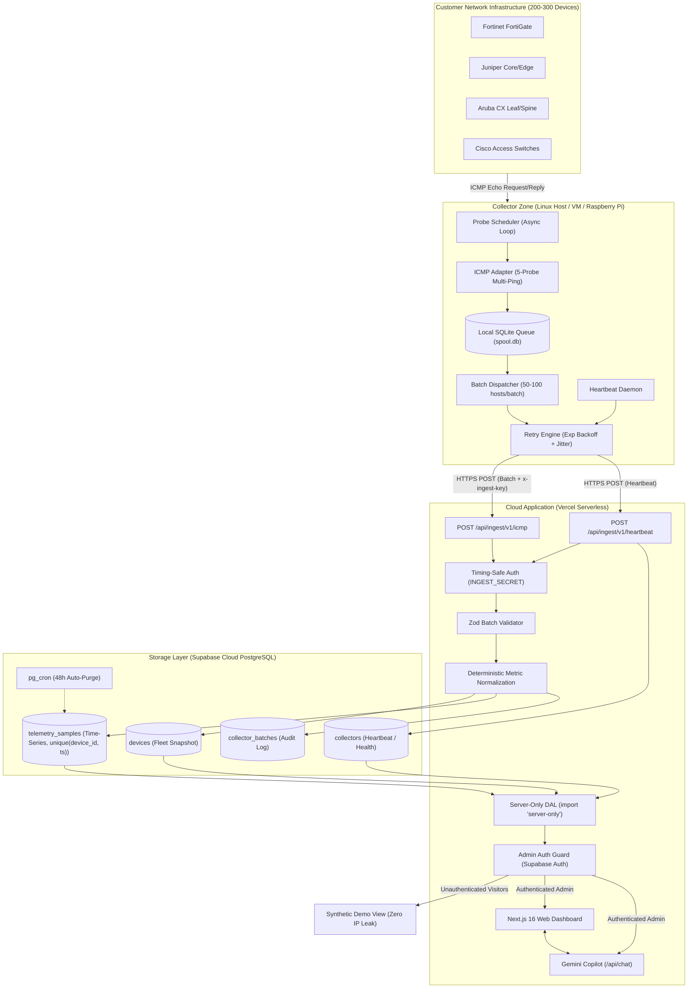
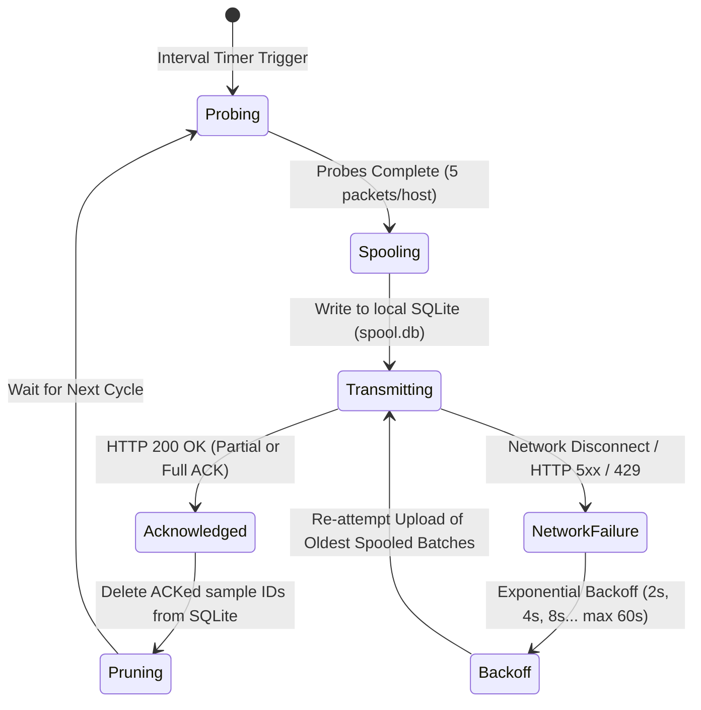

# NetPulse AI — System Architecture Specification
**Document Version**: 1.0.0 (Phase 1 ICMP MVP)  
**Authoritative Reference**: `NetPulse_AI_Day_14-40_Engineering_Learning_Roadmap.docx`  
**Status**: Approved Baseline for Phase 1 Implementation  

---

## 1. Executive Summary & Product Boundary

**NetPulse AI** is an enterprise-grade network monitoring platform designed for multi-vendor infrastructures (Fortinet firewalls, Juniper routers, Aruba Leaf/Spine and CX switches, Cisco appliances) across multiple data centers and campus sites.

### 1.1 Phase 1 MVP Scope (Day 40 Target)
The Day 40 deliverable is a resilient, authenticated **ICMP Telemetry Monitoring Platform** engineered to scale across 200–300 network devices:
- **Inventory Management**: Track devices, management IPs, vendor tags, model, role, and physical DC sites.
- **Out-of-Process Probing**: Continuous multi-probe ICMP execution from an edge Linux collector running outside the web serverless runtime.
- **Durable Local Queuing**: Local SQLite persistence (`spool.db`) ensuring zero telemetry loss during WAN disconnects or cloud ingestion backpressure.
- **Timing-Safe Ingestion API**: Authenticated batch processing with idempotent upserts.
- **Operational NOC Dashboard**: High-contrast Obsidian telemetry UI with live status pills, KPI ribbon, fleet table, and real-time latency oscilloscope.
- **Read-Only AI Copilot**: Scoped, server-side Gemini diagnostic assistant offering root-cause explanations and human-reviewed, whitelisted CLI troubleshooting suggestions.

### 1.2 Explicitly Out of Scope for Phase 1 (Deferred to Future Phases)
- Full SNMP MIB polling and interface bandwidth counters (Phase 2).
- BGP peer state monitoring and route table transition tracking (Phase 3).
- sFlow/NetFlow packet capture and traffic matrix analysis (Phase 4).
- gNMI / NETCONF streaming telemetry subscriptions (Phase 5).
- Autonomous CLI execution or configuration mutation over SSH (Strictly forbidden by AI safety policy).
- Multi-region active-active cloud disaster recovery.

---

## 2. Infrastructure & Target Scale

- **Scale Profile**: Designed for 200–300 devices initially, with an architectural ceiling of 1,000+ devices.
- **Probe Cadence**: 15–30 second polling cycles. Each target receives a 5-probe ICMP burst per cycle.
- **Daily Telemetry Volume**:
  $$\text{300 devices} \times \frac{86,400 \text{ sec/day}}{30 \text{ sec/cycle}} = 864,000 \text{ telemetry samples/day}$$
  At a 48-hour retention window, the database maintains approximately 1.73 million time-series sample rows.
- **Target Topologies**:
  - **Security Perimeter**: Fortinet FortiGate Firewalls (HA clusters)
  - **Core & WAN**: Juniper MX / SRX Routers
  - **Data Center Fabric**: Aruba CX Leaf & Spine Switches
  - **Campus Distribution / Access**: Aruba CX Switches, Cisco Catalyst Switches

---

## 3. Logical Component Architecture



---

## 4. Responsibility Boundaries (Strict Separation of Concerns)

| Component | Must Do | Must NOT Do |
|---|---|---|
| **Next.js UI** | Render fleet overview, sort/filter devices, render latency curves, manage user sessions. | **Never** execute ICMP probes directly; **never** connect to switches over SSH. |
| **Next.js Ingestion API** | Authenticate collector via timing-safe secret check; validate batch schema; compute deterministic metrics; upsert devices; insert samples; return ACK with accepted IDs. | **Never** run long-running probe loops; **never** expose service-role credentials to the browser. |
| **Python Edge Collector** | Schedule multi-probe ICMP bursts; record observation timestamps (`observed_at`); spool samples to local SQLite; transmit batches over HTTPS; delete **only** ACKed records; report heartbeats. | **Never** contain Supabase service-role keys; **never** trust memory alone for sample buffering. |
| **Supabase PostgreSQL** | Persist inventory, time-series samples, collector states, and batch audit logs; enforce compound unique constraints; run automated 48h data retention via `pg_cron`. | **Never** expose operational tables via direct anonymous SELECT access. |
| **Server-Only DAL** | Mediate all database interactions; enforce `import 'server-only'`; inject server-aggregated summaries into AI context; enforce demo/live data partitioning. | **Never** allow database client code to be bundled into client-side JS chunks. |
| **Gemini AI Copilot** | Analyze scoped telemetry provided by Server DAL; identify anomalies; propose copyable read-only diagnostic commands from approved whitelist. | **Never** execute CLI commands autonomously; **never** access arbitrary database tables; **never** run write operations. |

---

## 5. Protocol-Neutral Telemetry Envelope (Extensibility Model)

To guarantee that adding SNMP, BGP, or sFlow in future phases does not require redesigning the database, all telemetry adheres to a normalized envelope:

```typescript
export interface TelemetryEnvelope<T = Record<string, unknown>> {
  protocol: 'icmp' | 'snmp' | 'bgp' | 'sflow' | 'gnmi';
  metric_type: 'icmp_probe' | 'interface_counters' | 'bgp_peer_state' | 'flow_record';
  source_collector_id: string; // UUID of reporting collector
  observed_at: string;         // ISO 8601 UTC timestamp from edge sensor
  received_at?: string;        // ISO 8601 UTC timestamp upon cloud ingestion
  sequence_no: number;         // Incremental sequence for deduplication
  labels?: Record<string, string>; // e.g. { interface: "ge-0/0/1", vrf: "default" }
  payload: T;                  // Protocol-specific structured metric payload
}
```

### Phase 1 ICMP Specific Payload
```typescript
export interface IcmpProbePayload {
  sent_count: number;          // e.g. 5 probes
  received_count: number;      // e.g. 5 replies
  rtts_ms: (number | null)[];  // [14.2, 14.8, 15.1, 14.0, 14.5] (timeouts are null)
}
```

---

## 6. Edge Collector Reliability & Offline Spooling



- **Persistence-First Invariant**: Raw probe results are committed to SQLite (`spool.db`) before any network upload is attempted.
- **Partial ACK Awareness**: If Vercel accepts 45 samples and rejects 5, the collector deletes only the 45 accepted sample IDs and retains the 5 unacknowledged records for retry.
- **Restart Recovery**: If the Linux collector machine reboots unexpectedly, it resumes execution, detects pending batches in SQLite, drains the backlog, and re-establishes probe schedules.

---

## 7. Metrics & Monitoring Semantics

1. **Packet Loss**:
   $$\text{packet\_loss\_pct} = \frac{\text{sent} - \text{received}}{\text{sent}} \times 100$$
   *(If `received == 0`, latency statistics are `null`, never `0 ms`).*
2. **RTT Variation (Discrete Jitter)**:
   $$\text{rtt\_variation\_ms} = \frac{1}{N-1} \sum_{i=1}^{N-1} |RTT_{i+1} - RTT_i|$$
   *(Calculated over successful probes only. Explicitly named `rtt_variation_ms` to avoid confusion with RFC 3550 RTP streaming jitter).*
3. **Status Derivation (Server Authoritative)**:
   - **Up (Online)**: Packet loss $\le 1\%$ and latency within baseline.
   - **Degraded**: Packet loss between $2\%$ and $99\%$, or latency exceeds threshold.
   - **Down (Offline)**: $100\%$ packet loss sustained across consecutive probe cycles.
   - **Stale / Unknown**: No sample received within $3 \times$ probe interval.

---

## 8. Security Architecture & Threat Model

1. **Zero Anonymous Database Access**:
   Supabase Row Level Security (RLS) is enabled on all tables without any public SELECT policy. Client browsers have zero direct connection credentials to Supabase.
2. **Identity-Driven Data Serving**:
   - **Unauthenticated Visitors**: Server DAL returns synthetic mock devices (`10.0.0.x`). Real enterprise IPs and switch names are never transmitted to public browsers.
   - **Authenticated Administrators**: Access live data and unlock the Gemini Copilot upon verifying session cookies via Supabase Auth.
3. **Collector Authentication**:
   Requests to `/api/ingest/v1/*` must present an `x-ingest-key` header. The server performs a timing-safe equality check (`crypto.timingSafeEqual`) against `process.env.INGEST_SECRET`.
4. **AI Safety & Command Guardrails**:
   - Gemini has **zero execution paths** to hardware.
   - Suggested troubleshooting commands are strictly filtered through a read-only regex whitelist (e.g. `^show (interfaces|ip bgp summary|version).*$`, `^ethtool -S [a-z0-9]+$`).
   - Dangerous characters (`|`, `>`, `;`, `&&`, `rm`, `reload`) are rejected.
   - The UI labels all diagnostic proposals: *"AI Suggestion — Human verification required before running on terminal"*.
5. **Quota & Denial of Service Protection**:
   - Monthly budget cap and spending alerts set in Google AI Studio.
   - External Gemini calls wrapped in `AbortSignal.timeout(15000)`.
   - Max route execution bounded by `export const maxDuration = 30`.

---
*Signed off for Phase 1 Implementation — NetPulse AI Architecture Team (2026).*
