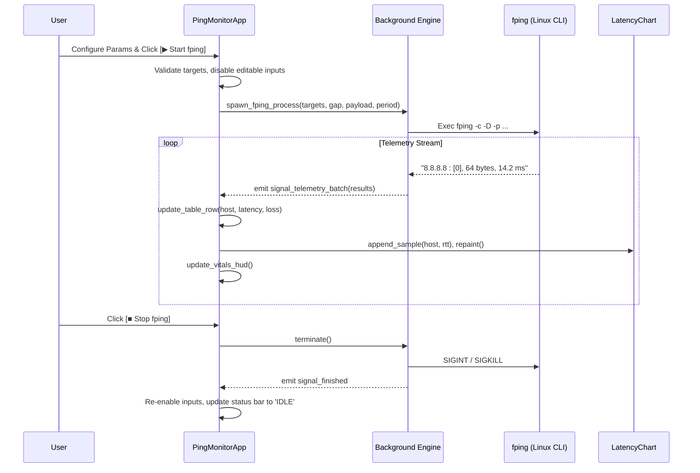

# Code Graph — fping_linux

> Generated via `code-graph` skill. High-performance asynchronous fping ICMP reachability engine, Linux telemetry console, and PySide6 UI graph.

---

## 1. System Architecture & Topology

```mermaid
flowchart TD
    subgraph Application Entry & Shell
        APP["fping_linux.py (PingMonitorApp: QMainWindow)"]
        CONF["fping_linux_config.json (Engine Configuration)"]
        PROBES["fping_linux_probes.py (ICMP, TCP, HTTP Probes & DNS)"]
    end

    subgraph Sidebar Cockpit
        HUD["MetricCard (Vitals Matrix HUD)"]
        FLEET["Target Fleet Console (Preset Chips, Host Input)"]
        PARAMS["Engine Timing & Buffer (SpinBoxes, Intervals)"]
        CTA["Start/Stop Engine Trigger (QPushButton#primaryBtn)"]
        EXPORT["Reports & Storage (CSV, XLSX, TXT, Clear)"]
    end

    subgraph Telemetry Core
        STREAM["Telemetry Matrix Stream (Active Hosts QTableWidget)"]
        INCIDENT["Incident Monitor (Unreachable Table)"]
        CHART["LatencyTelemetryOscilloscope (Custom QPainter Canvas)"]
    end

    subgraph Background Concurrency
        ENGINE["ProbeThread / QThreadPool"]
        FPING["fping Subprocess (Linux Native / Fallback)"]
    end

    subgraph Specialized Dialogs
        DETAIL["HostDetailDialog (Detailed Statistics)"]
        DNS_DLG["DNSIssuesDialog (DNS Anomaly Resolution)"]
    end

    APP --> CONF
    APP --> PROBES
    APP --> HUD & FLEET & PARAMS & CTA & EXPORT
    APP --> STREAM & INCIDENT & CHART
    APP --> DETAIL & DNS_DLG
    CTA -->|Launches / Stops| ENGINE
    ENGINE --> FPING
    FPING -->>|Pipes stdout/stderr| ENGINE
    ENGINE -->>|Signals| APP
    APP -->|Repaints & Updates Rows| STREAM & INCIDENT & CHART & HUD
```

---

## 2. Class & Symbol Dictionary

| Class / Symbol | File | Role & Key Responsibilities |
| :--- | :--- | :--- |
| `PingMonitorApp` | `fping_linux.py` | Main application controller, UI event loop, widget orchestration, style system |
| `LatencyChart` | `fping_linux.py` | High-frequency oscilloscope plotting min/avg/max latency waveforms via `QPainter` |
| `MetricCard` | `fping_linux.py` | Modern card displaying KPIs (Total Targets, Reachability, Avg RTT, Loss) |
| `HostDetailDialog` | `fping_linux.py` | Target breakdown inspector (jitter, standard deviation, loss percentage, uptime) |
| `DNSIssuesDialog` | `fping_linux.py` | Unresolved host diagnosis, resolver latency, and failover DNS advice |
| `BrandIconWidget` | `fping_linux.py` | Native squircle SVG branding renderer with green accent |
| `ICMPProbe` | `fping_linux_probes.py` | Low-level asynchronous socket and fping binary communication layer |
| `DNSResolver` | `fping_linux_probes.py` | Fast asynchronous host-to-IP resolution with caching and error trap |

---

## 3. Execution & Signal Flow



---

## 4. Blast Radius Matrix

| Component | Upstream Caller | Downstream Affected | Test Suite |
| :--- | :--- | :--- | :--- |
| `apply_style()` | Theme toggle, init | All widgets, tables, dialogs, charts | `pytest fping_linux/tests/test_ui_verification.py` |
| `fping_linux_probes.py` | `PingMonitorApp.start()` | Process parsing, target validation, DNS check | `pytest fping_linux/tests/test_fping_linux.py` |
| `start_btn` Layout | `sidebar_layout` | User workflow, tab indexing, UI order | Verified via offscreen grab test |
